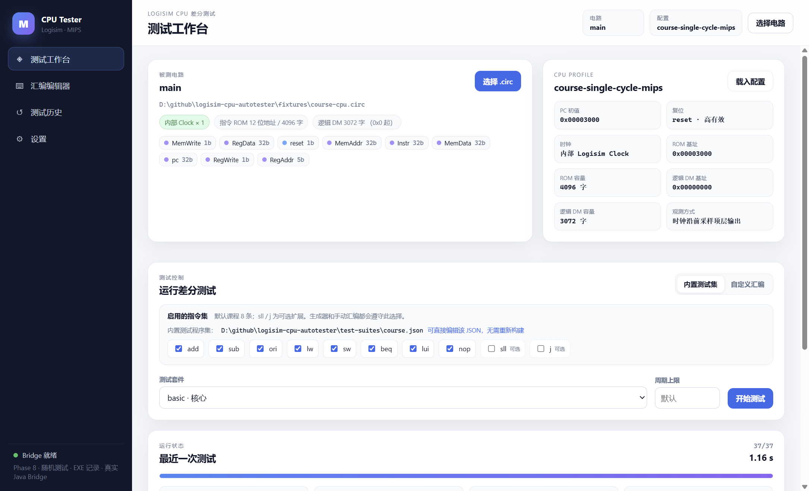
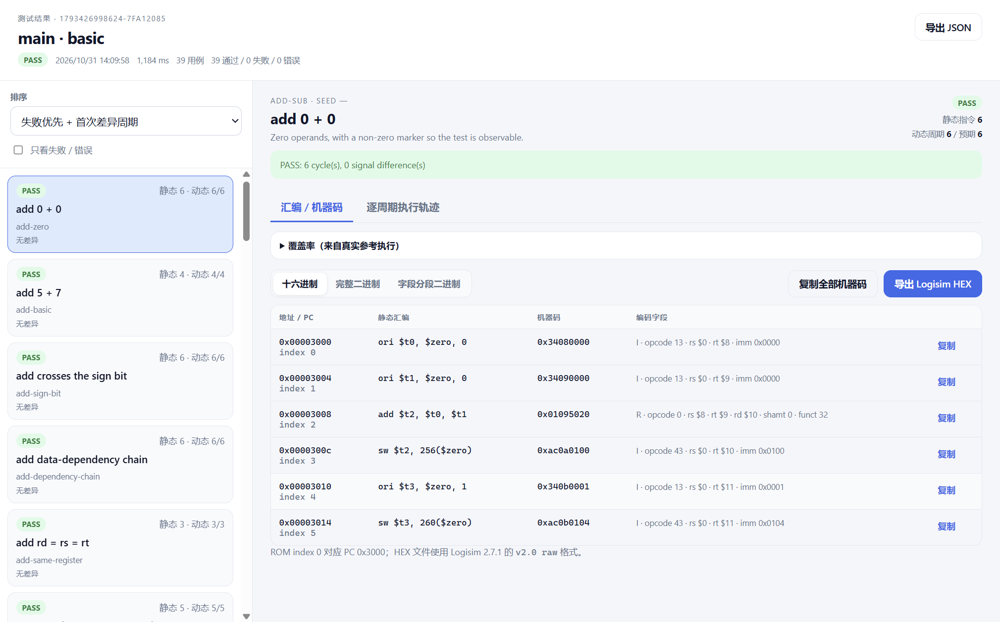
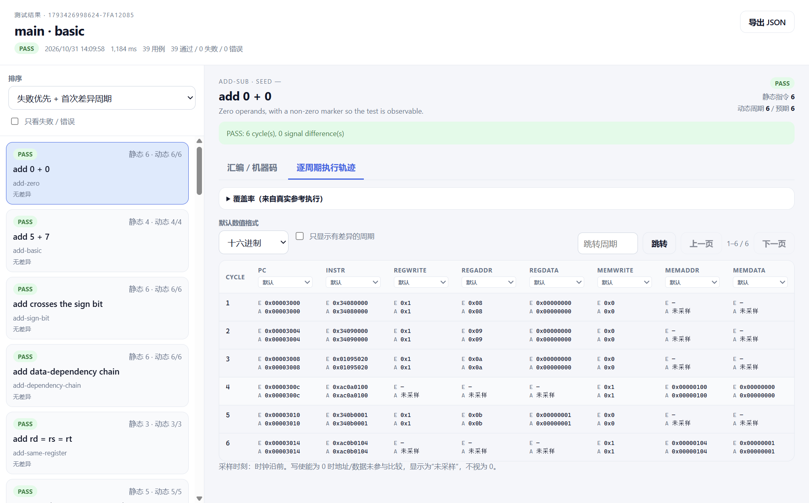
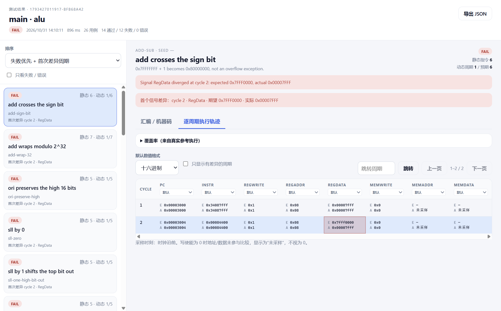

# Logisim CPU Autotester

**面向 BUAA《计算机组成原理》P3 的 Logisim MIPS 单周期 CPU 自动测试工具。**

加载你在 Logisim 2.7.1 中完成的 MIPS 单周期 CPU，自动注入测试程序、逐周期比较顶层信号，并在失败时定位到具体周期、PC、汇编指令和信号差异。


<p align="center">
  
</p>

## 为什么用它

P3 的 CPU 通常由数据通路、控制器、RegFile、ALU、ROM 和 DM 组成。手工仿真只能看到最终结果，很难发现：

- `sw` 的 NextPC 被错误地加上 offset；
- `lw/sw` 的负 offset 被零扩展；
- `ori` 的 16 位立即数被符号扩展；
- `lui` 写错高 16 位；
- `beq` 负偏移或 PC 高 4 位错误；
- 控制器把 `lw/sw/ori` 误译码成 `beq`；
- 寄存器写回或 DM 写事件在错误周期发生。

本工具用**参考模拟器 + 真实 Logisim CPU** 做黑盒差分：

- 时钟沿前采样 `Instr`、`pc`、`RegWrite/RegAddr/RegData`、`MemWrite/MemAddr/MemData`；
- 时钟沿后检查真实 `pc`；
- 每个周期都比较 PC/指令/写回，不只比较最终内存；
- 不读取 CPU 内部物理 RAM，不需要知道你的 RAM 组件名称、数量或地址位宽；
- 不修改你的 `.circ` 文件。

## 功能

- **零改造接入**：课程 Profile 只需顶层 `main`、`reset` 输入和 8 个观测输出，不需要在 CPU 里插入探针。
- **103 个自动化测试**：Bridge、汇编器、参考解释器、真实 CPU、GUI 服务、CLI、故障注入。
- **165 条外部测试程序**：默认八指令 147 条，启用可选 `sll`/`j` 后 165 条；JSON 可在软件外编辑。
- **动态指令集**：默认 `add/sub/ori/lw/sw/beq/lui/nop`，可选 `sll/j`；生成器、汇编器、参考模型和报告统一遵守。
- **LUI / J / NOP 完整支持**：编码、参考执行、真实 CPU、报告、结果窗口全链路。
- **符号扩展/32 位边界**：ORI 零扩展、LW/SW 符号扩展、LUI 高位、add/sub 溢出。
- **复杂控制流**：多路 beq、循环、状态依赖分支、非零 base 的 store/load、栈保存恢复。
- **随机测试**：seed + 数量生成确定性 constrained-random 程序。
- **独立结果窗口**：用例列表、首差异、PC/汇编/机器码、Expected/Actual 轨迹、覆盖率、HEX 导出。
- **EXE 同目录记录**：`test-records/` 保存设置和测试历史，支持逐条删除，便携可迁移。
- **Windows 一键便携版**：内置 Java runtime，解压双击运行，无需安装 Node/Electron/JDK。
- **可复现失败**：seed、测试程序、steps、首差异信号/周期都写入报告。

## 界面

| 工作台 | 独立结果窗口 |
|---|---|
|  |  |

| 逐周期 Expected / Actual | 失败首差异 |
|---|---|
|  |  |

## 快速开始

### 环境要求

- Windows 10/11（主要验证环境），macOS/Linux 可运行 CLI 与核心测试；
- Node.js **22+**（当前验证 24.16.0）；
- JDK **17+**（当前验证 Temurin 25.0.4.1）；
- 不需要安装 Logisim：项目固定使用 Logisim 2.7.1 JAR。

### 从源码运行

```sh
git clone https://github.com/PresKirimaSyaro/logisim-cpu-autotester.git
cd logisim-cpu-autotester

npm ci
npm test          # 103 个自动化测试
npm run gui       # 构建并启动 Electron 桌面应用
```

`npm run gui` 会构建 Java Bridge、TypeScript、Electron main/preload 和 Vite renderer。

### Windows 便携版

```sh
npm run dist:win
```

生成：

```text
release/Logisim CPU Tester/Logisim CPU Tester.exe
release/Logisim-CPU-Tester-win-x64.zip
```

解压后双击 `Logisim CPU Tester.exe`。包内包含 Electron、Logisim/Gson JAR、Java Bridge、fixtures、外部测试集和精简 Java runtime。

## 使用流程

1. 打开 GUI，点击 **选择 .circ**，加载你的 P3 CPU；
2. 确认 Profile 显示 `main`、内部 Clock、ROM 0x3000、逻辑 DM 3072 字、8 个输出；
3. 选择指令集（默认八条；需要时勾选 `sll`/`j`）；
4. 选择测试套件、周期上限；`stress`/`random` 可设置强度和 seed；
5. 点击 **开始测试**；
6. 完成后自动打开独立结果窗口：
   - 左侧查看 PASS/FAIL 和首次差异；
   - 右侧查看汇编/机器码、逐周期 Expected/Actual；
   - 点击失败周期可定位到静态指令；
   - 可导出 JSON 报告或 Logisim HEX。

### 课程 CPU 观测输出

| 信号 | 位宽 |
|---|---:|
| `Instr` | 32 |
| `pc` | 32 |
| `RegWrite` | 1 |
| `RegAddr` | 5 |
| `RegData` | 32 |
| `MemWrite` | 1 |
| `MemAddr` | 32 |
| `MemData` | 32 |

## 测试套件

| 套件 | 内容 | 当前结果 |
|---|---|---|
| `basic` | 核心 add/ori/lw/sw/beq 等 | 默认 **37/37** |
| `full` | 当前指令集下全部外部定向程序 | 默认 **147/147**，全开 **165/165** |
| `alu` | 算术、LUI、移位等 | 启用 sll 后 **58/58** |
| `memory` | 正负 offset、非零 base、DM/GRF 检查 | 通过 |
| `branch` | beq 多分支、循环、误译码回归 | 通过 |
| `stress` | 长循环、嵌套、栈、RAW、固定 seed | Quick **11/11**，Stress **18/18** |
| `random` | 确定性随机程序 | **5/5 E2E** |

### 外部测试程序集

定向测试不在运行时硬编码，而是读取：

```text
test-suites/course.json
```

- 修改/新增测试后，下一次运行直接生效，**无需重新编译**；
- 每条程序带 `assembly`、精确 `steps`、signature、suite 和 RAM 需求；
- 可使用自己的文件：

```sh
npm run test:cpu -- \
  --circuit fixtures/course-cpu.circ \
  --config fixtures/course.config.json \
  --suite basic \
  --suite-file test-suites/example.json
```

格式说明：[test-suites/README.md](test-suites/README.md)。

## 随机与 Stress

### 随机程序

```sh
npm run test:cpu -- \
  --circuit fixtures/course-cpu.circ \
  --config fixtures/course.config.json \
  --suite random --seed 1234 --seed-count 10
```

同一 seed 完全可复现；程序由随机 ALU/ORI/LUI、非零 base 的 lw/sw、仅前向 beq 构成，经真实参考解释器计算 steps/signature。

### Stress

```sh
npm run test:cpu -- --suite stress --intensity quick
npm run test:cpu -- --suite stress --intensity standard
npm run test:cpu -- --suite stress --intensity stress
```

Stress 档位包含 10,242 周期循环、14,339 周期栈保存/恢复、嵌套循环、循环访存、全 GRF、RAW 链和固定 seed 条件程序。

## 故障检出

工具包含目标故障回归，确保测试集不会把以下错误判为 PASS：

| 故障 | 检出方式 |
|---|---|
| `sw` 错误修改 NextPC | 真实故障 CPU fixture + 逐周期 PC |
| `lw/sw` offset 零扩展 | MemAddr/首差异 |
| `beq` 负偏移错误 | PC 逐周期比较 |
| `ori` 符号扩展立即数 | RegData |
| `lui` 高 16 位错误 | RegData |
| `add/sub` 最高位错误 | RegData |
| `lw/sw/ori` 被误当 beq | PC 逐周期比较 |

部分故障使用**受控参考 trace 变异**做回归，真实 `sw` NextPC 另有独立故障 CPU fixture；两者都不修改用户 `.circ`。

## CLI

```sh
npm run test:cpu -- \
  --circuit fixtures/course-cpu.circ \
  --config fixtures/course.config.json \
  --suite full
```

常用选项：

```text
--suite basic|full|branch|memory|alu|stress|random
--suite-file <path>       外部定向测试 JSON
--instructions <list>     启用指令集（如 add,sub,ori,lw,sw,beq,lui,nop,sll,j）
--intensity quick|standard|stress
--seed <n>
--seed-count <n>
--steps <n> / --stop-pc <addr>
--max-cycles <n>
--report <path>
--trace / --json / --list
```

退出码：`0` 全部通过；`1` 有 FAIL；`2` harness/配置/汇编错误。

## 报告与记录

便携版的设置和历史保存在 **EXE 同目录**：

```text
test-records/
  settings.json
  history/<id>.json
  history/<id>.meta.json
```

历史页支持：

- 打开独立结果窗口；
- 导出完整 JSON；
- 重跑失败用例；
- 删除单条记录（同时关闭对应结果窗口）。

复制整个便携目录即可迁移记录；`test-records/` 不进入 Git。

## 结果窗口

- 左侧：名称、静态指令数、动态/预期周期、PASS/FAIL/TIMEOUT/LIMIT/ERROR、首次差异周期和信号；失败优先，可排序和过滤。
- 汇编/机器码：ROM 地址/PC、源文本、32 位机器码、R/I/J 字段；HEX/完整二进制/分段二进制；复制和 Logisim HEX 导出。
- 轨迹：8 个顶层信号的 Expected/Actual、首差异高亮、只看差异、跳转周期、点击回静态指令；循环指令对应多个动态周期。
- 未知/错误/未采样值不显示为 0；写使能为 0 的地址/数据不参与比较。
- 长轨迹每页 200 周期。

## 架构

```text
apps/desktop       Electron main/preload、独立结果窗口
apps/renderer      React 工作台/编辑器/历史/设置/结果窗口
java-bridge        JSON Lines Java Bridge（原版 Logisim 内核）
packages/mips-core 汇编器、解码、参考解释器、配置、HEX
packages/differential-runner 差分执行、报告、覆盖率
packages/test-generator      外部 suite loader、random、Stress、迁移
packages/desktop-service     设置/历史/报告/运行服务
packages/cli                  CLI
test-suites                   外部测试程序集
fixtures                      课程/Phase 2/故障 CPU 与配置
docs                          设计、验证记录、截图
scripts                       构建、导出、打包
```

核心测试不依赖 Electron；`TesterService` 可在 Node 中直接测试。详细设计见 [docs/architecture.md](docs/architecture.md)、[docs/phase8-design.md](docs/phase8-design.md)。

## 验证状态

| 项目 | 结果 |
|---|---|
| `npm test` | **103 / 103 PASS** |
| 默认八指令 `full` | **147 / 147 PASS** |
| 全十指令 `full` | **165 / 165 PASS** |
| 课程 CPU `basic` | **37 / 37 PASS** |
| Phase 2 CPU 默认配置 | **121 / 121 PASS** |
| GUI smoke | 退出码 0 |
| Windows 便携版 smoke | 退出码 0 |

CI：GitHub Actions 矩阵覆盖 Ubuntu/Windows × JDK 17/25，运行 `npm ci` + `npm test`。验证记录：[docs/phase8-validation.md](docs/phase8-validation.md)、[docs/phase7-validation.md](docs/phase7-validation.md)、[docs/phase6-validation.md](docs/phase6-validation.md)。

## 已知限制

- 课程逻辑 DM 只有 3072 字；“高位 1 base + 负偏移”等组合只有在形成合法地址时才测试。
- 仅支持题目要求的单周期七/八指令及可选 `sll/j`；无异常、中断、流水线、halt。
- 逻辑 DM 初始化通过 `sw` 完成；不读取物理 RAM。
- 便携版 exe 未签名，SmartScreen 可能提示。
- Stress 全量报告较大，结果窗口按页读取。

## 文档

- [Phase 8：随机测试、EXE 记录、删除](docs/phase8-validation.md)
- [Phase 7：新增 100 条测试](docs/phase7-validation.md)
- [Phase 6：外部测试集与便携版](docs/phase6-design.md)
- [Phase 5：动态指令集与故障注入](docs/phase5-design.md)
- [Phase 4：独立结果窗口与 Stress](docs/phase4-design.md)
- [Phase 3：桌面 GUI](docs/phase3-design.md)
- [Phase 2：差分核心](docs/phase2-design.md)
- [协议](docs/protocol.md)
- [黑盒 DM 设计](docs/blackbox-dm.md)
