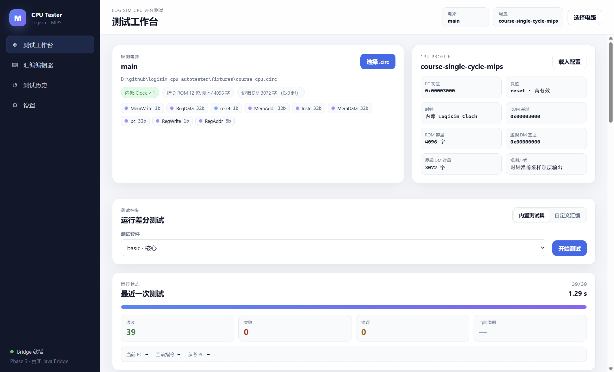
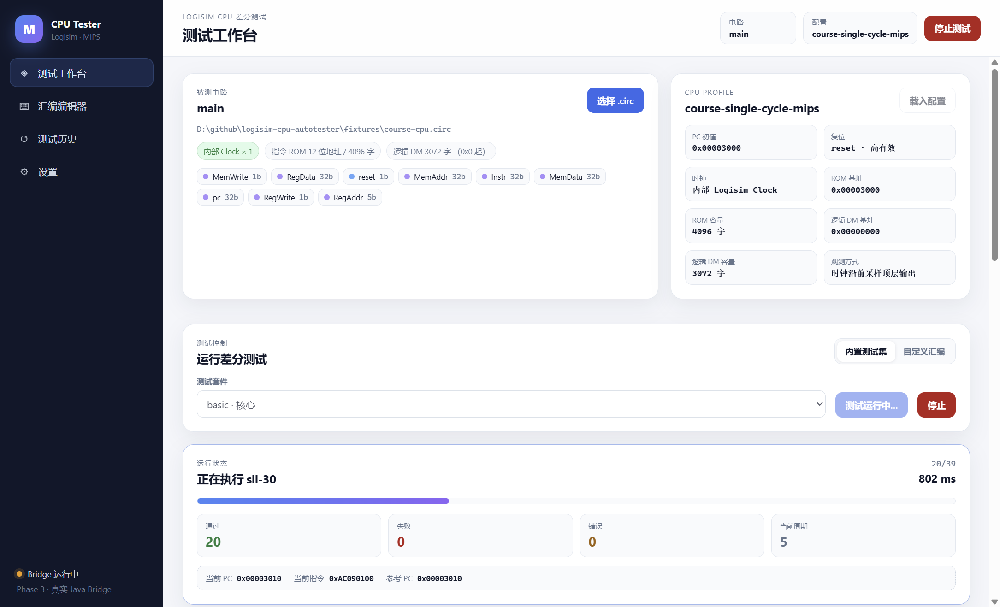
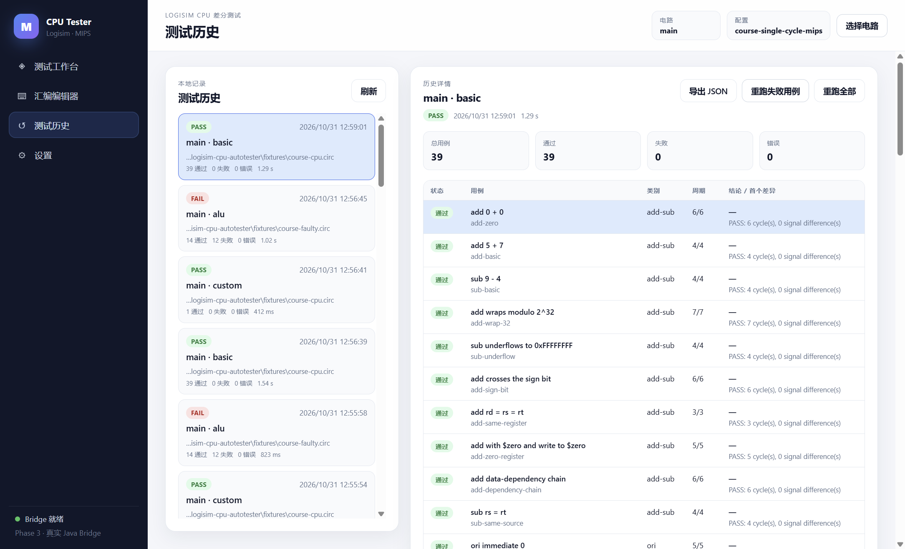
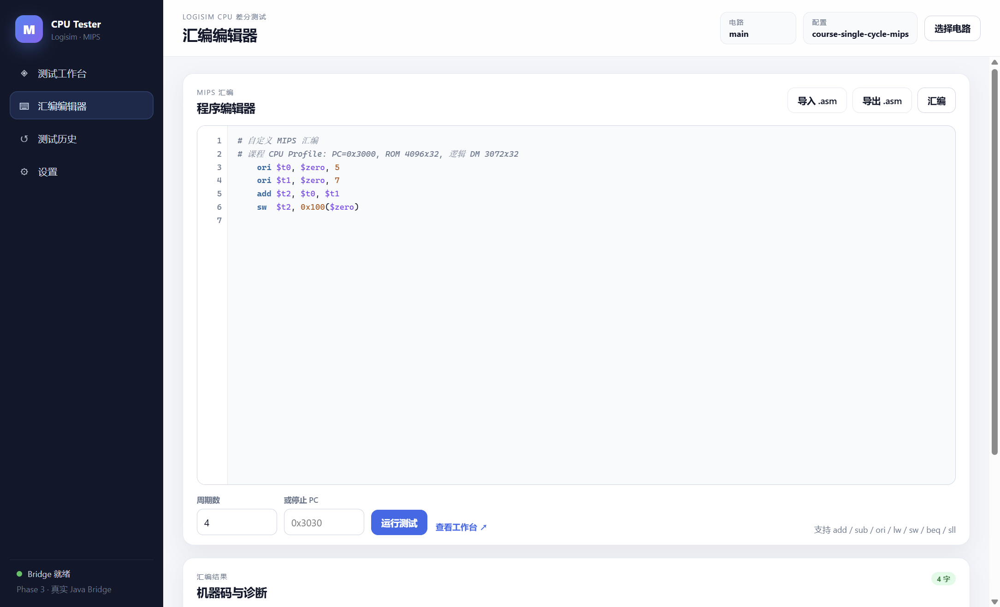
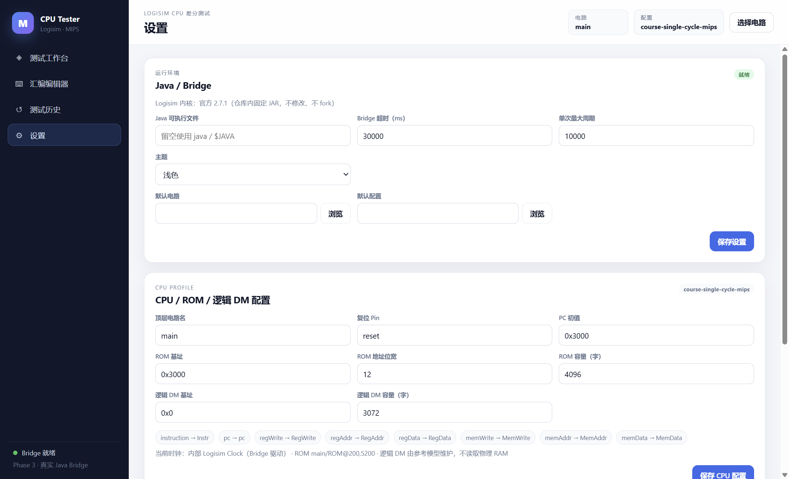
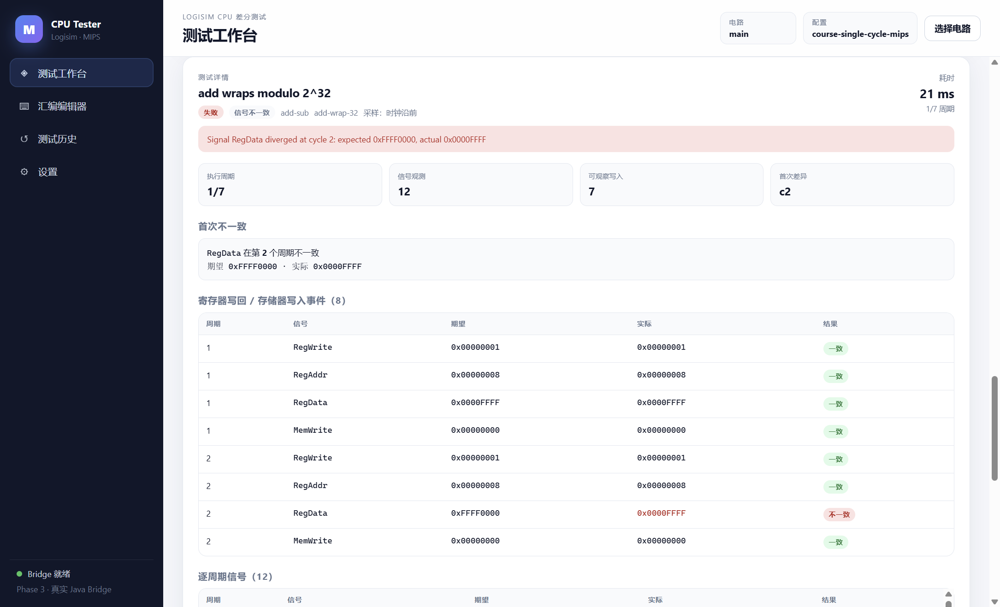

# Phase 3 实际运行记录（黑盒 DM）

日期：2026-10-31。环境：Windows、Temurin OpenJDK **25.0.4.1**、Node.js **24.16.0**、Electron **45.2.1**、Logisim 原版 **2.7.1**。所有 GUI 运行都启动真实 Java Bridge，没有用截图或 mock 结果替代测试。

> 自本轮修改起，测试只依赖 CPU 顶层可观察行为。物理 RAM 数量、位宽、层级和内容不参与测试；逻辑 DM 只存在于参考模型。设计细节见 [blackbox-dm.md](blackbox-dm.md)。

## 1. 自动化测试

```sh
npm test
```

结果：退出码 **0**，**70 tests / 70 pass / 0 fail / 0 skipped，约 13.47 秒**。完整原始输出：[phase3-test-run.txt](phase3-test-run.txt)。

| 测试组 | 数量 | 内容 |
|---|---:|---|
| Phase 1 Bridge | 8 | 真实 Logisim 加法器/层级/寄存器/振荡/进程异常/JSON Lines |
| Assembler | 8 | 七指令黄金机器码、字段、标签、范围、诊断 |
| Reference interpreter | 13 | 解码、PC、add/sub 模运算、ori/sll、lw/sw、$zero、分支、地址映射、trace |
| Config | 8 | 严格 schema、逻辑 DM、旧物理字段迁移、PC/reset |
| Generator | 4 | 49 例参考执行/步数/signature、GRF、32 种 sll、seed 可重复、suite/layout |
| Bridge memory | 6 | 底层 ROM/RAM/Register 诊断、层级发现、32 位注入、错误码 |
| Real CPU E2E | 12 | 课程/Phase 2 CPU 各 49/49、多 RAM、零 `readMemory`、$zero 无效果写、sw/lw、故障/死 CPU、无输出拒绝、Bridge 失败 |
| Desktop service | 5 | 课程 CPU、多 RAM、真实套件、自定义汇编、历史/导出、停止、设置持久化 |
| CLI | 6 | `--asm`、多 RAM、移除 `--range`、失败信号、错误退出码、`--list` |

## 2. 课程 CPU Profile

```sh
node dist/packages/cli/src/main.js \
  --circuit fixtures/course-cpu.circ \
  --config fixtures/course.config.json \
  --suite full
```

结果：**49 total / 49 pass / 0 fail / 0 error**，退出码 **0**。完整输出：[phase3-course-full.txt](phase3-course-full.txt)。

该 CPU 满足：

- 顶层 `main`，唯一输入 `reset`，内部 Logisim Clock。
- 8 个标准输出：`Instr`、`pc`、`RegWrite`、`RegAddr`、`RegData`、`MemWrite`、`MemAddr`、`MemData`。
- ROM 4096×32，PC 初值 `0x3000`，索引 `(PC - 0x3000) >>> 2`。
- 逻辑 DM 3072 字；物理 RAM 组件是否存在、数量、位宽均不影响测试。
- 每个周期在时钟沿前比较 8 个信号、沿后比较 PC；49 例全部一致。

多物理 RAM 验收：

```sh
node dist/packages/cli/src/main.js \
  --circuit fixtures/course-multi-ram.circ \
  --config fixtures/course.config.json \
  --suite full
```

`fixtures/course-multi-ram.circ` 在课程 CPU 上额外放置 3 个未使用 RAM；CLI/E2E 均 **49/49 PASS**，没有读取或拒绝这些 RAM。CLI 输出：[phase3-course-multi.txt](phase3-course-multi.txt)。

受控课程故障 CPU：

```sh
node dist/packages/cli/src/main.js \
  --circuit fixtures/course-faulty.circ \
  --config fixtures/course.config.json \
  --suite alu
```

结果：**26 total / 14 pass / 12 fail / 0 error**，退出码 **1**。输出：[phase3-course-faulty.txt](phase3-course-faulty.txt)。失败详情定位到首个信号不一致（`RegData`，周期 2）。

物理 RAM 读取隔离：

- `tests/e2e/cpu.test.ts` 使用代理桥记录所有 `readMemory` 调用，断言调用数为 0；ROM 注入与 DM 都不读取物理内存。
- `runTest` 拒绝非空 `initialRam`，要求用 `sw` 初始化逻辑 DM。
- 配置 `ram.path`、`ram.addressBits`、`compare` 可迁移但被忽略；`ram.initial` 非空明确报错。

## 3. Electron GUI smoke

```sh
npm run gui:smoke
```

结果：退出码 **0**。该命令：

1. 构建 Java/TypeScript/Electron main/preload/Vite renderer。
2. 启动真实 Electron 窗口（非浏览器 mock）。
3. 加载 `fixtures/course-cpu.circ`。
4. 通过**界面上的“开始测试”按钮**经 preload → IPC → main → TesterService 运行 basic 套件。
5. 等待真实 Java Bridge 完成 **39/39 PASS**。
6. 切换到历史页面截图；在编辑器点击“汇编”，验证 4 条机器码，再点击“运行测试”完成自定义 4 周期测试 **1/1 PASS**。
7. 切换到设置页面截图。
8. 加载 `fixtures/course-faulty.circ`，运行 alu 套件，截图失败详情（26 例中 14 通过、12 失败）。

完整 stdout/stderr：[phase3-gui-smoke.txt](phase3-gui-smoke.txt)。

截图（真实 2169×1317 窗口）：













工作台显示：课程 Profile、内部 Clock ×1、唯一指令 ROM、逻辑 DM 3072 字、39 通过/0 失败、当前 PC/指令区域、用例列表；历史页显示本地持久化记录并自动打开最新记录；编辑器显示高亮、行号、4 条机器码和符号表；失败详情显示“首次不一致”、寄存器写回/访存事件、逐周期信号、汇编、机器码和 Bridge 状态。GUI 不展示物理 RAM 数量或内容。`SMOKE_CUSTOM_ASM` 明确记录 `{"total":1,"passed":1,"failed":0,"errors":0,"skipped":0}`。

## 4. Desktop service（不依赖 Electron）

`tests/desktop/service.test.ts` 直接实例化 `TesterService`，使用真实 Bridge：

- 加载 `fixtures/course-cpu.circ`，校验 `main`、内部时钟、PC=0x3000、唯一 ROM、逻辑 DM。
- 保存并重新载入修改后的 CPU 配置，验证 JSON 读写。
- 汇编 `ori/ori/add/sw` 得到黄金机器码。
- 运行 alu 套件 **26/26**，验证实时 `currentPc/currentInstruction` 进度事件、历史写入/读取/导出。
- 运行自定义汇编 4 周期，1/1 PASS。
- 停止 full 套件：不会把未完成运行报告为 PASS；若产生历史记录，`complete=false`，界面显示“已停止”。
- 设置写入后新实例读取到持久化值。
- 加载 `fixtures/course-multi-ram.circ` 成功并运行 basic **39/39**。
- 加载非课程电路 `fixtures/cpu.circ` 时明确报错，不伪造 Profile。

## 5. 安全性验证点

- `contextIsolation: true`、`nodeIntegration: false`、`sandbox: true`。
- preload 只暴露 `window.cpuTester` 的固定方法；Renderer 无法传任意 IPC channel。
- 文件选择在 main 用 `dialog`；服务再次校验扩展名和文件存在。
- Renderer 中 `child_process`/`fs`/Java 调用为零；Vite 产物在 smoke 中实际加载。
- 导航被限制为本地 `file://`，新窗口被拒绝；CSP 限制脚本/样式。
- 设置/历史写入 `app.getPath('userData')/logisim-cpu-tester`；不写仓库或用户 `.circ`。

## 6. 已知限制

- GUI 没有安装包/签名；通过 `npm run gui` 从源码启动。
- 没有完整波形查看器、电路编辑器、AI 识别、通用 Circuit IR 或自动失败缩减。
- 黑盒模式要求 8 个顶层观测输出；缺少时明确报错，不回退到物理 RAM。
- 内部 Clock 由 `clockCycle` 两次半周期驱动；不支持多相/门控时钟或每周期多条指令。
- 逻辑 DM 不能从外部预置初始内容；必须用 `sw` 初始化。
- 历史记录把完整报告保存在本地；大量 49 例运行会占用磁盘。
- 未在 Linux/JDK 17 实机验证 Electron；CI 目前已覆盖 Node/Java 测试矩阵，GUI 只在本机 Windows 运行。
