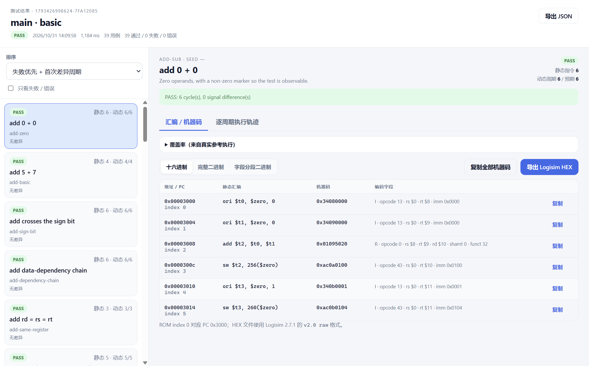
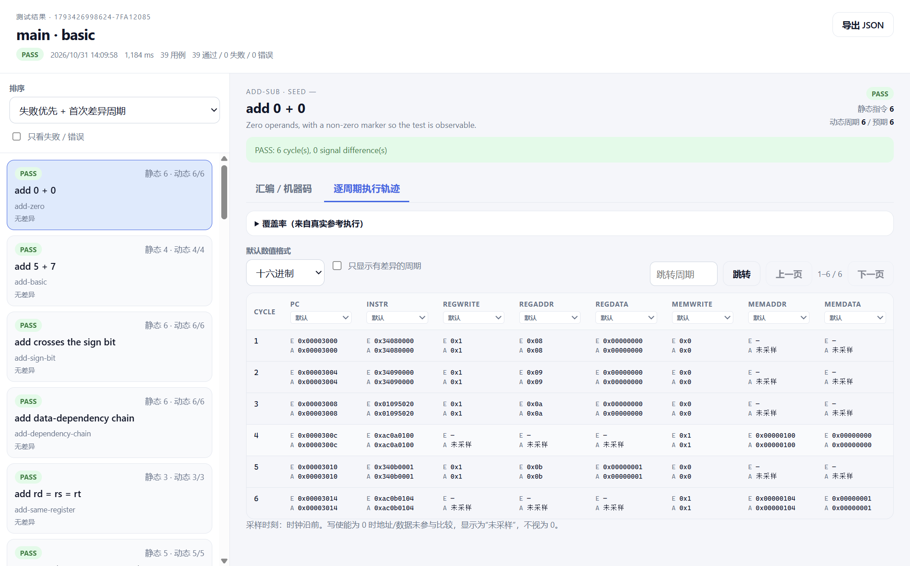
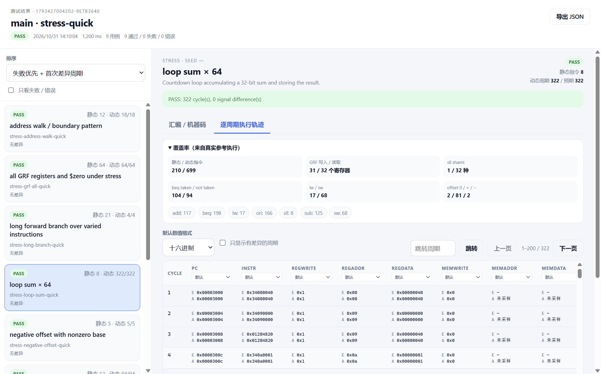
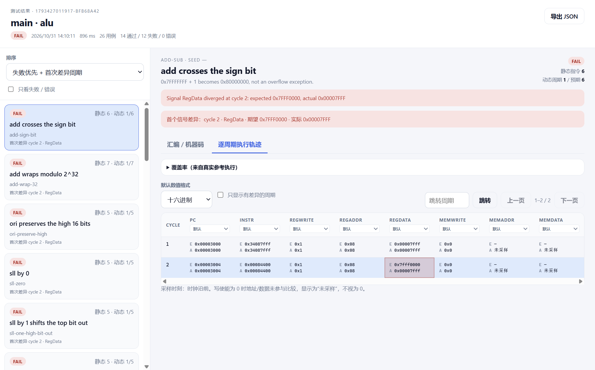

# Phase 4 实际运行记录

日期：2026-10-31。环境：Windows、Temurin OpenJDK **25.0.4.1**、Node.js **24.16.0**、Electron **45.2.1**、Logisim 原版 **2.7.1**。所有 GUI/结果窗口均来自真实 Java Bridge 报告，没有 mock 结果。

## 1. 自动化测试

```sh
npm test
```

结果：退出码 **0**，**82 tests / 82 pass / 0 fail / 0 skipped，约 17.09 秒**。原始输出：[phase4-test-run.txt](phase4-test-run.txt)。

| 测试组 | 数量 | 内容 |
|---|---:|---|
| Phase 1 Bridge | 8 | 真实 Logisim、层级、寄存器、振荡、进程异常、JSON Lines |
| Assembler | 8 | 七指令黄金机器码、标签/范围/诊断 |
| Reference interpreter | 13 | 解码、PC、ALU、访存、分支、地址映射、trace |
| Config | 8 | 逻辑 DM、课程 Profile、迁移字段、PC/reset |
| Generator | 5 | 49 例定向、GRF、32 位 sll、seed、Stress Quick/Standard/Stress |
| Bridge memory | 6 | 底层 ROM/RAM/Register 诊断与错误码 |
| Real CPU E2E | 15 | 课程/Phase2 49/49、多 RAM、Stress、cycle-limit、$zero、sw/lw、unknown、故障/死 CPU、无输出拒绝 |
| Desktop service | 6 | 报告 meta/test/trace 分页、HEX、Stress、历史、停止、设置 |
| CLI | 7 | asm、多 RAM、Stress+coverage、移除 range、失败信号、错误、list |
| Signal format | 3 | 32 位/5 位/1 位的 HEX/U/S/BIN、未采样/未知/错误 |
| Logisim HEX | 3 | TS 往返、注释/run-length、原版 `HexFile.parse` 实际解析 |

## 2. 结果窗口 smoke

```sh
npm run gui:smoke
```

退出码 **0**。实际执行：

1. 构建 Java/TypeScript/Electron main/preload/Vite 多入口 renderer。
2. 启动主窗口，加载课程 CPU。
3. 点击“开始测试”运行 basic：**39/39 PASS**。
4. 先从历史页点击记录打开独立结果窗口，再从工作台“打开测试结果窗口”按钮打开同一报告，验证两个入口均按报告 ID 创建/复用 BrowserWindow；截取汇编/机器码页面。
5. 切换“逐周期执行轨迹”，截取 Expected/Actual 表。
6. 运行 Stress Quick，打开 stress 结果窗口，选择 `loop sum × 64`（静态 8 行、动态 322 周期），截取覆盖率、分页 1–200/322 与轨迹。
7. 运行自定义汇编：**1/1 PASS**。
8. 运行课程故障 CPU alu：**26 例，14 PASS / 12 FAIL**，首个信号 `RegData` cycle 2。
9. 关闭结果窗口不影响主窗口/服务；结果窗口可独立调整大小。

完整 stdout/stderr：[phase4-gui-smoke.txt](phase4-gui-smoke.txt)。

截图：









主窗口：[工作台](screenshots/workbench.png) · [历史](screenshots/history.png) · [运行中](screenshots/running.png)。

## 3. 独立窗口/报告验收

- 正常运行时工作台 `finished` 事件自动打开结果窗口；smoke 为便于截取显式关闭自动打开，改为分别点击历史记录和“打开测试结果窗口”，两条入口都验证创建/复用同一报告 ID 的 BrowserWindow。
- 主窗口“打开测试结果窗口”使用 `lastReportId`；历史页点击记录/按钮打开同一报告 ID。
- 结果窗口通过 `report:meta`、`report:test`、`report:trace` 获取数据，不读取主窗口 React state。
- 每页轨迹 200 行；Stress loop 322 周期显示 `1–200 / 322`，可上一页/下一页/跳转。
- 列表默认失败优先，可按状态/静态/动态/首次差异排序，可只看失败。
- 静态指令数与动态周期数分开：`loop sum × 64` 显示静态 8、动态 322/322；`beq-backward-loop` 等循环同样区分。
- 机器码 R/I 字段、HEX/完整二进制/分段二进制；复制单条/全部；HEX 文件使用原版 `HexFile.parse` 验证。
- 首差异单元格高亮；点击周期定位到静态汇编行；循环同一静态指令对应多个周期。
- 数值格式全局 + 每信号局部；测试验证 32 位 `0xAC0A0100`、5 位、1 位补零/符号/截断。
- 未知/错误/未采样保持独立状态；写使能为 0 的地址/数据不参与比较，显示“未采样”。

## 4. Stress 结果

`npm run test:cpu -- --suite stress --intensity quick --json`：

- **9/9 PASS**，coverage 来自真实参考执行。
- Stress 结果窗口示例：静态 210 / 动态 699，GRF 写 31 / 读 32，beq taken 104 / not 94，lw 17 / sw 68，offset 0/+/− = 2/81/2。
- Stress `loop sum × 64`：静态 8、动态 322；`stress` 档位 loop-sum 超过 **10k** 周期，静态程序仍远低于 ROM 4096 指令。
- 课程 CPU 上实际运行 `--suite stress --intensity stress`：**16/16 PASS**，包含 10,242 周期的 loop-sum、全部 GRF、嵌套循环、循环访存和固定 seed 程序。输出：[phase4-stress-full.txt](phase4-stress-full.txt)。
- 执行使用 64 周期 batch；服务层进度按 150ms/32 周期节流。
- `maxCycles=100` 的 loop 测试状态为 `error/cycle-limit`，`cyclesCompleted=100`，不是 PASS/FAIL。

## 5. CLI/兼容

- CLI `--suite stress --intensity quick` 通过；`--seed-count` 可覆盖固定 seed 数量。
- CLI 旧 `--asm`、多 RAM、失败信号、错误退出码、`--list` 继续通过。
- 课程/Phase2 49 例原有黑盒测试继续通过。
- 旧历史报告可打开；缺失静态指令时服务可重建，缺失轨迹显示未采样，不伪造。
- 主窗口不保存详细结果；`getState().lastSummary.results` 为空，报告完整内容按 ID 存储。
- 用户 `.circ` 不被修改；HEX 导出只写用户选择的新 `.hex` 文件。

## 6. 已知限制

- 结果窗口/报告窗口没有安装包签名；通过 `npm run gui` 源码启动。
- 历史报告仍是单个 JSON 文件；Stress 全量报告可能较大，已通过元数据/单测试/分页读取避免主窗口与结果窗口一次性渲染全部轨迹。
- 未实现完整波形查看器、电路编辑器、AI 或通用电路 IR。
- `cycle-limit` 在 UI 显示 LIMIT（errorType），不新增破坏 totals 的独立 status 字段。
- 未在 Linux/JDK 17 实机验证 Electron。
