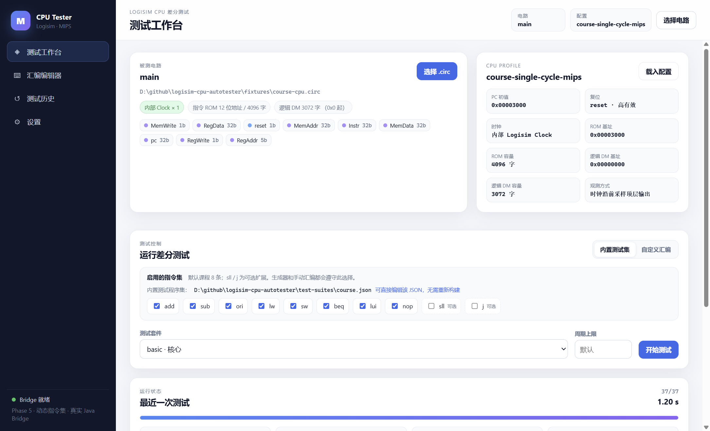
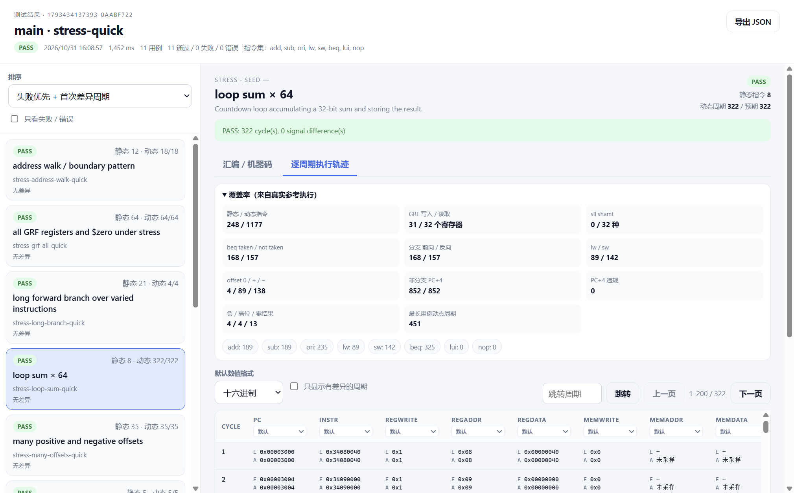
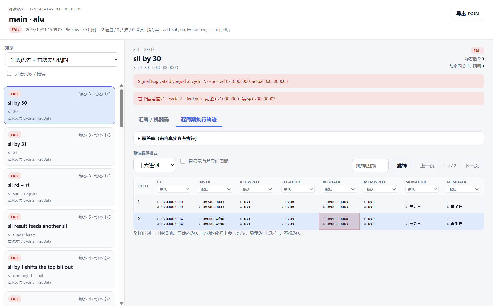

# Phase 6 实际运行记录

> Phase 7 已将外部程序集扩展到 165 条（默认 147）并把测试组提升到 99；当前结果以 [phase7-validation.md](phase7-validation.md) 为准，本文保留 Phase 6 当时记录。

日期：2026-10-31。环境：Windows、Temurin OpenJDK 25.0.4.1、Node.js 24.16.0、Electron 45.2.1、Logisim 原版 2.7.1。

## 1. 自动化测试

```sh
npm test
```

退出码 **0**：**96 tests / 96 pass / 0 fail / 0 skipped，约 21.9 秒**。原始输出：[phase6-test-run.txt](phase6-test-run.txt)。

新增验证：

- 外部 suite loader：65 条、默认过滤 47 条、签名索引映射、重复 id/空签名拒绝。
- Service/CLI 从 `test-suites/course.json` 读取，不再调用运行时硬编码定向用例。
- 真实 CPU 全部通过；Phase 2 外部集合自动跳过需要 3072 字 RAM 的测试，不发生越界。
- 六类故障注入、NextPC 故障 CPU、动态指令集、Stress、HEX、结果窗口全部继续通过。

## 2. 外部测试集实测

默认：

```text
test-suites/course.json: 65 tests
默认八指令过滤: 47/47 PASS
全十指令过滤: 65/65 PASS
```

自定义文件：

```sh
node dist/packages/cli/src/main.js \
  --circuit fixtures/course-cpu.circ \
  --config fixtures/course.config.json \
  --suite basic --suite-file test-suites/example.json
```

结果：`1 total, 1 pass`。没有重新构建 JavaScript。

GUI 工作台显示：

```text
内置测试程序集：
.../resources/app/test-suites/course.json
可直接编辑该 JSON，无需重新构建
```

每次开始测试重新读取文件。

## 3. Windows 便携版

构建：

```sh
npm run dist:win
```

结果：

```text
release/Logisim CPU Tester/Logisim CPU Tester.exe
portable size: 414.4 MB
zip:          release/Logisim-CPU-Tester-win-x64.zip (190.5 MB)
external suite in package: resources/app/test-suites/course.json (65 tests)
```

包含：

- Electron 45.2.1（`Logisim CPU Tester.exe`）；
- `resources/app/dist`（main/preload/renderer/packages）；
- `resources/app/java-bridge/build/classes`；
- `resources/app/vendor/logisim-generic-2.7.1.jar`、Gson；
- `resources/app/fixtures`；
- `resources/app/test-suites/course.json` + example；
- `resources/app/runtime`（jlink 精简 Java runtime，49.2 MB）。

### 双击/启动验证

以打包后的 exe 运行 smoke：

```powershell
Start-Process "release\Logisim CPU Tester\Logisim CPU Tester.exe" -Wait
```

（smoke 模式由环境变量触发；普通双击不设置该变量。）

退出码 **0**，二次重建后的最终打包版验证。普通双击（不设置 smoke 环境变量）也启动成功，窗口标题为 `Logisim CPU Tester`，进程响应正常，并自动加载便携包内的课程 CPU。

- 默认八指令勾选、sll/j 未勾选；
- basic 37/37；
- Stress Quick 11/11；
- 故障 CPU alu 30 例，22 PASS / 8 FAIL，结果窗口显示首个差异；
- 独立结果窗口、编辑器、设置、覆盖率、指令集 header 正常；
- 使用打包的 Java runtime，不依赖 PATH 中的 java。

证据：[phase6-packaged-smoke.txt](phase6-packaged-smoke.txt)（来自打包版 smoke 的 stdout）。

工作台外部测试集与便携 smoke：







## 4. 兼容/限制

- 用户历史/设置仍在 `%APPDATA%\Logisim CPU Tester\logisim-cpu-tester`。
- 外部测试集在程序目录内可编辑；升级替换程序目录前应备份自定义 JSON。
- exe 未签名，SmartScreen 可能提示。
- jlink runtime 由构建机 JDK 25 生成；未在 Linux/JDK 17 实机验证。
- 便携目录不是单文件自解压 exe；分发时可整体压缩为 zip。
