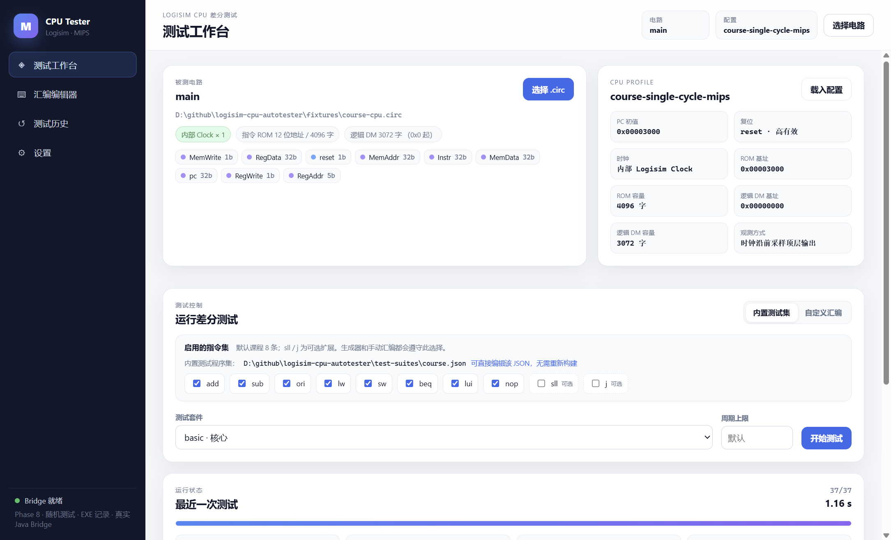
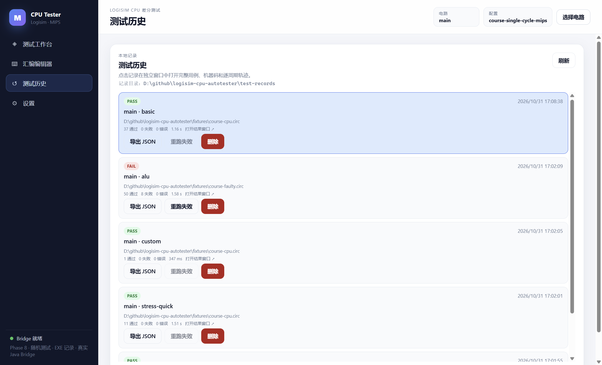

# Phase 8 实际运行记录

日期：2026-10-31。环境：Windows、Temurin OpenJDK 25.0.4.1、Node.js 24.16.0、Electron 45.2.1、Logisim 原版 2.7.1。

## 1. 随机测试

```sh
node dist/packages/cli/src/main.js \
  --circuit fixtures/course-cpu.circ --config fixtures/course.config.json \
  --suite random --seed 1234 --seed-count 3 --json
```

结果：**3/3 PASS**，3 条结果均带 seed `1234`，ID 以 `random-` 开头。

- 同一 seed 生成完全相同的程序（生成器单测）。
- 不同 seed 生成不同程序。
- 程序只使用当前启用指令；要求 `ori` + `sw` 以生成常量和可观察 signature。
- E2E：随机 5 条在真实课程 CPU 上 **5/5 PASS**。
- 2 条生成器确定性/指令集测试通过。

## 2. 记录目录

开发版 `test-records/`、便携版 **EXE 同目录** `test-records/`：

```text
release/Logisim CPU Tester/
  Logisim CPU Tester.exe
  test-records/
    settings.json
    history/<id>.json
    history/<id>.meta.json
```

打包版 smoke（basic + custom + Stress + 故障）后实测：

```text
test-records/history: 4 条 meta
```

历史页显示 `记录目录：...\test-records`。便携版不再使用 `%APPDATA%`。打包前已删除 smoke 产生的记录，最终 zip 内不包含用户数据。

## 3. 删除记录

- Service 测试实际执行：删除 alu 记录后 `getHistory` 返回 null，列表由 2 变 1；再次删除返回 `deleted:false`。
- 历史页每条记录有“删除”按钮，确认后调用 `history:delete`；main 同时关闭该报告对应的独立结果窗口。
- 运行中删除被拒绝。

## 4. 自动化

```sh
npm test
```

退出码 **0**：**103 tests / 103 pass / 0 fail / 0 skipped，约 32.6 秒**。原始输出：[phase8-test-run.txt](phase8-test-run.txt)。

原有 165 条外部测试集和 147 条默认过滤集继续通过；随机/删除测试组新增。

## 5. GUI smoke

```sh
npm run gui:smoke
```

退出码 **0**：

- 默认指令集八条；
- basic 37/37；
- Stress Quick 11/11；
- 故障 CPU alu 58 例，50 PASS / 8 FAIL；
- 历史页显示记录目录和删除按钮；
- 结果窗口正常。

截图：





## 6. 打包

```sh
npm run dist:win
```

结果：

```text
release/Logisim CPU Tester/Logisim CPU Tester.exe
portable size: 414.5 MB
release/Logisim-CPU-Tester-win-x64.zip (190.5 MB)
```

打包版 smoke 退出码 **0**；检查确认：

- `test-records/` 创建在 exe 同一层；
- `resources/app/test-suites/course.json` 为 165 条；
- `resources/app/runtime/bin/java.exe` 存在；
- 不含 `builtin-directed.js`。

## 7. 注意

- 未签名 exe 可能触发 SmartScreen。
- 便携目录需要可写；放在 Program Files 等受保护目录时记录创建会失败，建议放在用户目录。
- `test-records` 会随整个便携目录迁移；升级时注意备份。
